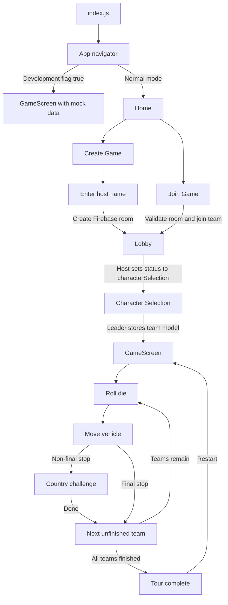
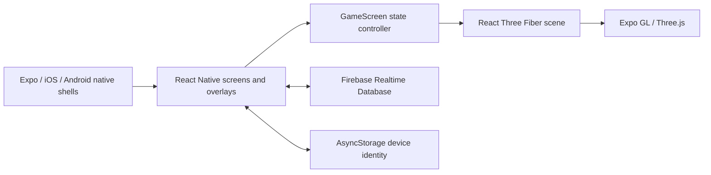

# TipsyTraveller: Game and Architecture Documentation

> Detailed reference for the current implementation of TipsyTraveller.
>
> Last reviewed against the source code: 17 October 2026.

## Table of contents

1. [Project overview](#1-project-overview)
2. [Current implementation status](#2-current-implementation-status)
3. [Player experience and game rules](#3-player-experience-and-game-rules)
4. [Application flow](#4-application-flow)
5. [Gameplay state machine](#5-gameplay-state-machine)
6. [Technical architecture](#6-technical-architecture)
7. [Screen-by-screen reference](#7-screen-by-screen-reference)
8. [3D board architecture](#8-3d-board-architecture)
9. [Dice implementation](#9-dice-implementation)
10. [Vehicle movement](#10-vehicle-movement)
11. [Challenges](#11-challenges)
12. [Firebase and multiplayer data](#12-firebase-and-multiplayer-data)
13. [Navigation contracts](#13-navigation-contracts)
14. [Assets and visual design](#14-assets-and-visual-design)
15. [Native projects and platform configuration](#15-native-projects-and-platform-configuration)
16. [Running and building the project](#16-running-and-building-the-project)
17. [Testing guide](#17-testing-guide)
18. [Known limitations and technical debt](#18-known-limitations-and-technical-debt)
19. [Safe extension points](#19-safe-extension-points)
20. [File and component reference](#20-file-and-component-reference)

---

## 1. Project overview

TipsyTraveller is a mobile party board game built around a configurable road trip. Players join a four-digit room, are divided into teams, select a vehicle, roll a 3D die, travel between destinations on a rendered map, and perform a location-themed challenge after each stop.

The route, destinations, map artwork, and challenge content should be treated as replaceable game data rather than a permanent list. More locations, alternate routes, and new challenge types can be added as the game grows.

The presentation combines two rendering systems:

- React Native renders screens, forms, buttons, lobby content, the HUD, and challenge cards.
- Three.js, through React Three Fiber and Expo GL, renders the map, route, markers, vehicles, camera, and interactive die.

Firebase Realtime Database provides room creation, joining, team rosters, lobby updates, host reconnection metadata, and selected team models. AsyncStorage gives each installation a persistent anonymous device identifier.

### Product identity

- App name: `TipsyTraveller`
- Package version: `1.0.0`
- iOS bundle identifier: `com.nielspet.TipsyTraveller`
- Android application ID: `com.nielspet.TipsyTraveller`
- Firebase project: `tipsy-travellers`
- EAS project ID: `fc6c433d-6c8c-4f79-b758-1d6b47ed5ee9`
- Primary visual palette:
  - Cream: `#FAF3E0` / `#FFF1CD`
  - Dark blue: `#2C3E50` / `#223144`
  - Teal: `#1BA39C`
  - Red: `#D71920`
  - Yellow: `#FFD700`
- Primary typefaces: Dogica Pixel and Dogica Pixel Bold

### Main technology stack

| Area | Technology |
|---|---|
| Application framework | Expo SDK 54 |
| UI framework | React Native 0.81 / React 19 |
| JavaScript engine | Hermes |
| Native architecture | React Native New Architecture enabled |
| Navigation | React Navigation stack |
| 3D rendering | Three.js, React Three Fiber, Drei, Expo GL |
| Realtime backend | Firebase Realtime Database |
| Local identity | AsyncStorage |
| Animation | React Native Animated and Lottie |
| Orientation | Expo Screen Orientation |
| Native builds | Xcode/CocoaPods and Gradle |
| Cloud builds | Expo Application Services (EAS) |

---

## 2. Current implementation status

This document distinguishes between the visible product concept and what the current code actually does.

### Implemented

- Home screen with create-game and join-game routes.
- Three-step game setup: difficulty, duration, and player range.
- Four-digit room creation with collision checking.
- Anonymous device identity persisted in AsyncStorage.
- Room joining and automatic team balancing.
- Two-team games for the `1-4` and `5-8` settings.
- Three-team games for the `9-12` setting.
- Realtime lobby roster updates.
- Basic host reconnection/expiration metadata.
- Team-leader vehicle selection with a rotating 3D preview.
- Landscape 3D board.
- Interactive 3D die with pickup, drag, throw, bounce, and result animation.
- Alternative HUD button for immediately generating a roll.
- Animated vehicle movement along a curved route.
- Animated country markers and camera following.
- Configurable location challenge cards.
- Turn switching, route completion, and local restart.
- iOS 27/Xcode 27 development support through Device Hub.

### Partially implemented

- Multiplayer synchronization stops after lobby/model selection. Live turns and board progress are local React state.
- Team leaders can select vehicles, but the character-selection screen does not coordinate completion across all teams.
- Reconnection recognizes the original host device, but no full game-state restoration exists.
- Difficulty and duration are stored in Firebase but do not modify gameplay.
- Profile and settings icons are visible but have no actions.
- The lobby `RULES` button logs to the console instead of opening rules.
- The game shows “Tour complete” when all teams finish, but it does not rank teams or announce a winner.

### Development-mode behavior

`app/app/devGameRoute.js` currently contains:

```js
export const START_ON_DEV_GAME_SCREEN = __DEV__ && true;
```

Therefore, every development build starts directly on `GameScreen` with mock data. The home, setup, join, lobby, and character-selection screens still exist, but they are bypassed unless this flag is changed to `false`.

The development game creates two teams and assigns both the classic car. Its room ID is `DEV-0000`; it does not create that room in Firebase.

---

## 3. Player experience and game rules

### Intended session

1. One player creates a game and becomes the host and Team 1 leader.
2. The host chooses difficulty, duration, and a player-count range.
3. The host enters a name and receives a four-digit game ID.
4. Other players enter that ID and a username.
5. The backend assigns joining devices to the least populated valid team.
6. The host sees the realtime team roster and starts the game when the minimum number of players is present.
7. Each team leader selects a vehicle.
8. Teams take turns rolling a die.
9. A team advances by the rolled number of route stops, capped at the final stop.
10. On a non-final landing, the active team performs the displayed country challenge.
11. Pressing `DONE / NEXT TURN` passes play to the next unfinished team.
12. Finished teams are skipped in later turn rotation.
13. The game ends after every team reaches the configured final stop.

### Team count rules

| Player setting | Teams | Room capacity | Minimum to start |
|---|---:|---:|---:|
| `1-4` | 2 | 4 | 2 |
| `5-8` | 2 | 8 | 2 |
| `9-12` | 3 | 12 | 3 |

The host is inserted into Team 1 as its leader. In a two-team room, the first joining player assigned to Team 2 becomes Team 2’s leader. In a three-team room, the first member of any empty team becomes that team’s leader.

### Route and stop numbering

The board route is an ordered collection of destination coordinates joined by travel legs. A typical route contains:

- A starting stop.
- One or more intermediate destinations.
- A final stop, which may return to the starting location or end elsewhere.

Stop index `0` is the initial position. Every following index represents another destination along the route. Intermediate stops may resolve to a challenge, while the final stop completes that team’s journey. The exact number of stops and their names are content choices and can change without altering the basic turn state machine.

The current implementation stores route geometry and display names in `constants/route.js` and challenge content in `constants/challenges.js`. Those files contain the active content set, but this architecture document intentionally does not duplicate that list because routes and challenges are expected to expand over time.

### Roll behavior

- Rolls are integers from 1 through 6.
- Movement cannot overshoot the finish.
- Landing at the finish immediately marks that team done.
- Landing before the finish opens a challenge.
- There is no collision rule; multiple teams may occupy the same stop.
- There are no shortcuts, reverse movement, bonus rolls, or stored penalties in the current code.
- Drinking penalties are instructions only; the app does not record whether a challenge was passed or failed.

---

## 4. Application flow



### Navigation stack

The root `Stack.Navigator` contains:

1. `Home`
2. `CreateGameScreen`
3. `HostName`
4. `JoinGameScreen`
5. `LobbyScreen`
6. `GameScreen`
7. `CharacterSelection`

Every stack header is hidden; each screen supplies its own header or controls.

---

## 5. Gameplay state machine

`GameScreen` is the authoritative controller for a local board session. It owns the state machine and passes data and callbacks into the renderer and overlays.

```mermaid
stateDiagram-v2
    [*] --> waiting
    waiting --> rolling: 3D die picked up/thrown
    waiting --> moving: HUD Roll Dice button
    rolling --> moving: die animation reports result
    moving --> challenge: vehicle lands before finish
    moving --> waiting: vehicle finishes; another team remains
    moving --> done: vehicle finishes; all teams done
    challenge --> waiting: Done / Next Turn
    challenge --> done: no unfinished team remains
    done --> waiting: Restart
```



### State values

| State | Meaning | Input allowed |
|---|---|---|
| `waiting` | Active team may roll | 3D die and HUD roll button enabled |
| `rolling` | 3D die is animating | Additional rolls blocked |
| `moving` | Active vehicle is travelling | Roll controls blocked |
| `challenge` | Landing challenge is visible | Only challenge completion advances play |
| `done` | Every team has finished | Restart button enabled |

### State owned by `GameScreen`

| Value | Purpose |
|---|---|
| `state` | Current phase listed above |
| `activeTeamIndex` | Index of the team whose turn it is |
| `lastRoll` | Most recent die result |
| `remainingMoves` | Number of route legs in the current move; this value is set initially and not decremented during movement |
| `movingPieceId` | Team ID whose model should animate |
| `moveTargets` | Map of team ID to destination leg |
| `currentChallenge` | Challenge record for the latest non-final landing |
| `teamProgress` | Per-team `{ currentLeg, isDone }` data |
| `pieceRefs` | React refs for each Three.js vehicle group, used by the camera |

### Turn rotation

`getNextActiveTeamIndex` scans forward, wraps around, and returns the next team whose `isDone` flag is false. If no unfinished team exists, it returns `null` and the game enters `done`.

### Reset behavior

Restart clears rolls, targets, active movement, challenges, and team progress. It does not modify Firebase and does not ask other devices to restart.

---

## 6. Technical architecture

### High-level layers



### Responsibilities

- `index.js` registers the root React component through Expo.
- `app/app/app.js` loads fonts and owns navigation.
- Screen folders own user-flow pages and Firebase actions.
- `GameScreen.js` owns the local game rules and turn state.
- `GameScene.js` composes the 3D world but does not decide game rules.
- `GameScreen/constants/` contains board geometry, route data, challenges, team definitions, camera positions, and model metadata.
- `firebaseConfig.js` initializes the Firebase app and exports the Realtime Database client.
- `assets/` holds board textures, vehicle models, marker geometry, fonts, images, and Lottie animations.
- `ios/` and `android/` are generated/prebuilt native projects with local compatibility changes.

### Rendering boundary

The game screen deliberately overlays ordinary React Native views above the GL canvas:

```text
GameScreen root View
├── GameScene (full-screen GL Canvas)
├── GameHud (React Native absolute overlay)
├── TourControl (React Native absolute overlay)
└── ChallengePopup (React Native modal-style absolute overlay)
```

This keeps long text, buttons, and accessibility semantics out of WebGL while reserving WebGL for spatial content.

### Data ownership

| Data | Owner | Persistent? | Shared? |
|---|---|---:|---:|
| Device ID | AsyncStorage | Yes | No |
| Room settings | Firebase `games/{gameID}` | Yes | Yes |
| Team roster | Firebase `players/{gameID}` | Yes | Yes |
| Team model choice | Firebase `games/{gameID}/teamModels` | Yes | Yes |
| Current turn | `GameScreen` React state | No | No |
| Die result | `GameScreen` React state | No | No |
| Team route progress | `GameScreen` React state | No | No |
| Current challenge | Derived/local React state | No | No |

---

## 7. Screen-by-screen reference

### `Home`

Purpose: entry point for normal sessions.

- Shows the looping globe Lottie animation and TipsyTraveller wordmark.
- Shows the tagline “Take a roadtrip and drink your way to victory!”
- `CREATE GAME` navigates to `CreateGameScreen`.
- `JOIN GAME` navigates to `JoinGameScreen`.
- Profile and settings icons are decorative at present.

### `CreateGameScreen`

Purpose: collect the room configuration in three sequential steps.

1. Difficulty: `easy`, `medium`, or `hard` (displayed as Easy, Medium, Lethal).
2. Duration: `short`, `medium`, or `long`.
3. Player range: `1-4`, `5-8`, or `9-12`.

The next button only advances after the current option is selected. The final step navigates to `HostName` with the settings as route parameters.

Current caveat: difficulty and duration are persisted but are not consumed by the game rules. All three duration choices also reuse the beer-bottle images originally used for difficulty.

### `HostName`

Purpose: establish host identity and create the Firebase room.

Creation sequence:

1. Reject an empty username.
2. Read `deviceID` from AsyncStorage or generate one from random base-36 text plus the current timestamp.
3. Generate a random four-digit string.
4. Query `games/{code}` and retry until the code is unused.
5. Write settings, host name, creation timestamp, device ID, and `status: "lobby"`.
6. Initialize `players/{code}` with a counter and three empty team placeholders.
7. Push the host into Team 1 as `isLeader: true`.
8. Register an `onDisconnect` update that writes `disconnectedAt` on the game.
9. Navigate to `LobbyScreen`.

### `JoinGameScreen`

Purpose: validate a room, restore host identity if appropriate, and join a team.

- Game IDs are numeric and limited to four digits by `NumberInput`.
- The screen rejects missing fields and unknown room codes.
- If `disconnectedAt` is more than ten minutes old, the room is treated as expired.
- If the saved device ID matches `hostDeviceID`, the player is recognized as the host, the disconnect marker is cleared, and a new disconnect handler is registered.
- A device already found in a team is not inserted again.
- New players are assigned to the least populated team allowed by the selected player range.

### `LobbyScreen`

Purpose: show synchronized teams and allow the host to start.

- Subscribes to `players/{gameID}` and `games/{gameID}` using Firebase `onValue`.
- Renders Team 1, Team 2, and optionally Team 3.
- The host may remove non-leaders.
- Once the minimum team-leader count is reached, the host may manually add local/offline players by name.
- Only the host can start.
- Start writes `games/{gameID}/status = "characterSelection"`.
- Every lobby client observing that status navigates to `CharacterSelection`.

The `RULES` button is currently a placeholder.

### `CharacterSelection`

Purpose: let a device identified as a team leader choose that team’s vehicle.

- Preloads all GLB vehicle assets.
- Locates the current device in the passed `teamMembers` object.
- Only leaders see the model carousel and confirm button.
- The preview clones the GLTF scene and rotates it continuously at `0.5` radians per second.
- Confirm writes the selected model ID to `games/{gameID}/teamModels/{teamKey}`.
- Confirm then replaces the screen with `GameScreen` on that device.
- Non-leaders see “Waiting for teamleader...”.

Current caveat: this screen does not subscribe to model selections or a game-start status. A non-leader does not automatically proceed, and leaders may enter the game at different times with incomplete model data.

### `GameScreen`

Purpose: run the board state machine, assemble team pieces, and connect 3D events to native overlays.

- Locks the device to landscape while mounted.
- Creates two or three game pieces based on `nrOfPlayers`.
- Resolves model choices from `gameData.teamModels`, falling back to the classic car.
- Creates a ref and progress record for each team.
- Handles rolling, movement targets, landings, challenges, turn switching, finish state, and restart.
- Unlocks orientation on unmount.

---

## 8. 3D board architecture

### Canvas

`GameScene` creates a React Three Fiber native `Canvas` with:

- Legacy mode enabled.
- A 50-degree field of view.
- Antialiasing requested.
- High-performance power preference requested.
- Premultiplied alpha disabled.
- One ambient light, one hemisphere light, and two directional lights.

All asset-dependent content is inside a React `Suspense` boundary with a null fallback. Until the texture and GLTF assets finish loading, the canvas can appear empty.

### Scene graph

```text
Canvas
├── Lights
├── CameraController
└── Suspense
    ├── MapPlane
    ├── GamePieces
    │   └── GamePiece × 2 or 3
    ├── DottedRouteLine
    ├── CountryMarkers
    │   └── CountryMarker × 7
    └── BoardDice
```

### Coordinate system

The map is treated as a 20-by-15 Three.js plane:

- Width: `20`
- Height: `15`
- Vertical center: `0.5`
- Base Z depth: `-1`
- Default content clearance above the map: `0.08`

Route coordinates are authored in normalized image UV space. The helper `uv(u, v)` converts them into world coordinates:

```text
x = (u - 0.5) × map width
y = (0.5 - v) × map height + map center Y
z = map Z + clearance
```

This allows route control points to be aligned visually to the map texture using normalized image positions rather than hard-coded world positions.

### Map plane

`MapPlane` builds the physical board as layered meshes:

1. Dark outer frame.
2. Cream inner frame.
3. Offset dark shadow plane.
4. Main map plane using `assets/europe-map4.png`.
5. Two subtle color overlays.
6. Four inner-edge strips.
7. Four decorative corner studs.

The map texture is resolved through `expo-asset` and loaded with Drei’s `useTexture`.

### Route curve

Each travel leg is an array of country endpoints plus intermediate control points. Each leg becomes a centripetal Catmull-Rom curve. The legs are also flattened into a single `DRIVE_CURVE`.

The global curve is used for:

- Route-dot placement.
- Vehicle positions.
- Vehicle tangent/heading.
- Mapping country stops to travel distances.

For every intermediate country stop, the code samples up to 1,200 points on the remaining curve to find the closest point. That produces `STOP_PROGRESS`, which is multiplied by the curve length to create `STOP_DISTANCES`.

### Dotted route

Dots are placed approximately every `0.19` world units along the global curve. Each dot has shadow, cream, and red layers. Every sixth dot receives a small yellow diamond accent.

The dot list is memoized so it is not recalculated on each React render.

### Country markers

- The marker model is `assets/models/location.glb`.
- Every marker clones the shared GLTF scene.
- Mesh materials are replaced with red or gold `MeshStandardMaterial` instances.
- The next destination is considered active.
- Active markers rotate and display a pulsing outer ring.
- Marker geometry is re-centered with a Three.js bounding box before placement.

### Camera

The camera has two modes:

- `done`: smoothly returns to a fixed board overview.
- `follow`: follows the active vehicle using a fixed offset.

Position and look-at target are interpolated every frame. The interpolation factor is derived from frame delta and capped at 1, preventing frame-rate-dependent jumps.

---

## 9. Dice implementation

`BoardDice` is a custom 3D interaction and animation system; it does not use a physics engine.

### Geometry

- The die body is a Drei `RoundedBox` measuring `0.48` units per side.
- Each of six faces has a manually defined transform.
- Pips are small circle meshes placed from lookup tables.
- Opposite faces use the standard 1/6, 2/5, and 3/4 pairing.
- A pixel-art “THROW ME” label is assembled from tiny plane cells.

### Internal modes

The die keeps its high-frequency animation state in refs rather than React state:

| Mode | Behavior |
|---|---|
| `idle` | Floats, spins, and displays “THROW ME” |
| `held` | Follows the pointer above the board |
| `throwing` | Performs airborne and rolling animation |
| `result` | Shows the enlarged face result, then returns to idle |

### Interaction sequence

1. Pointer down on the die calls `beginPickup`.
2. Pointer movement is projected onto an invisible board-sized plane.
3. The point is clamped to `DICE_BOUNDS` so the die remains on the board.
4. Recent drag displacement is smoothed into a throw direction.
5. Pointer up generates a random result from 1 through 6.
6. Throw strength slightly modifies rolling distance.
7. The die animates through a parabolic airborne stage.
8. It rolls and bounces toward the final position.
9. Rotation is interpolated to an orientation that shows the result face.
10. `onRollComplete(result)` tells `GameScreen` to move the vehicle.
11. A camera-facing result card rises above the landing position for 2.4 seconds.

The throw lasts 1.75 seconds; the first 42% is airborne.

### HUD roll shortcut

The `Roll Dice` button in `TourControl` calls `GameScreen.handleRoll()` directly. It generates the same random range but does not animate the die. This is useful as a fallback when pointer interaction is inconvenient.

---

## 10. Vehicle movement

### Model configuration

`MODEL_OPTIONS` defines eight vehicles:

- Classic Car
- Vehicle 1
- Minivan
- Vehicle 2
- Vehicle 3
- Vehicle 4
- Vehicle 5
- Vehicle 6

Each record contains:

- Stable ID stored in Firebase.
- Human-readable label.
- Bundled GLB source.
- Whether to normalize its origin.
- Whether to preserve texture-based materials.
- Per-model scale, position, and rotation corrections.

Unknown IDs fall back to the classic car. Every team also defaults to the classic car when no model selection is present.

### Model preparation

`GamePiece` clones the loaded GLTF scene so teams do not mutate one shared scene instance. It then:

- Disables frustum culling on child meshes.
- Replaces materials with team-colored paint, dark parts, glass, or lights for the classic-style model.
- For `preserveMaterials` models, clones a visible texture into a basic material, sets sRGB color space, and disables `flipY`.
- Optionally computes a bounding box and subtracts its center to normalize the model origin.

### Motion

- Progress is stored as distance along the global route curve.
- Each frame adds `delta × 0.44` world units while driving.
- Position comes from `DRIVE_CURVE.getPointAt(normalizedDistance)`.
- Heading comes from the route tangent plus a 90-degree model correction.
- Angular interpolation uses shortest-angle math to avoid full spins at the `−π/π` boundary.
- A small sine bounce gives the car motion.
- The active moving vehicle gets a pulsing team-colored glow.
- When target distance is reached, `onMoveComplete(teamId, targetLeg)` fires exactly once.

---

## 11. Challenges

Challenges are static records in `constants/challenges.js`. Each has:

- Country
- Title
- Prompt
- Failure penalty
- Accent color

The popup is a React Native overlay styled as a travel ticket. It contains a country stamp, mission code, team badge, route rail, three-letter country code, challenge text, penalty, and completion button.

### Animation system

Four `Animated.Value` objects drive:

- Spring entrance with translation, scaling, and rotation.
- Continuous pulse on badges, route dots, and button.
- Horizontal shimmer across the ticket.
- Slow floating of layered ticket cards.

All animations use the native driver. Loops are stopped during cleanup.

### Completion semantics

The button does not record success or failure. It simply closes the challenge, identifies the next unfinished team, clears the latest roll, and returns the game to `waiting`. Penalties are social instructions for the players to apply themselves.

---

## 12. Firebase and multiplayer data

### Database structure

The current code expects this conceptual Realtime Database shape:

```json
{
  "games": {
    "1234": {
      "difficulty": "medium",
      "duration": "short",
      "nrOfPlayers": "1-4",
      "persons": {},
      "HostName": "Niels",
      "createdAt": 1792195200000,
      "hostDeviceID": "random-and-timestamp-id",
      "status": "lobby",
      "disconnectedAt": 1792195800000,
      "teamModels": {
        "team1": "car1",
        "team2": "vehicle003"
      }
    }
  },
  "players": {
    "1234": {
      "playerCounter": 0,
      "team1": {
        "firebasePushKey": {
          "name": "Niels",
          "isLeader": true,
          "deviceID": "random-and-timestamp-id"
        }
      },
      "team2": {
        "firebasePushKey": {
          "name": "Player 2",
          "isLeader": true,
          "deviceID": "another-id"
        }
      },
      "team3": ""
    }
  }
}
```

The timestamp above is illustrative. Firebase may omit keys whose values are set to `null`, and empty-string team placeholders become objects once players are pushed.

### Room creation

Room IDs are random four-digit strings. They can begin with zero. Collision avoidance is performed client-side by reading the candidate game path and retrying until it does not exist.

This is not transactional: two hosts could theoretically test the same unused ID simultaneously. A production implementation should reserve IDs atomically or use Firebase-generated room IDs plus a separate join-code mapping.

### Identity model

There are no Firebase Authentication users. The client stores a locally generated `deviceID` and includes it in player records. This supports duplicate-join prevention, leader detection, and recognizing the original host on the same installation.

Consequences:

- Clearing app storage changes identity.
- A reinstall generally changes identity.
- Device IDs are not cryptographic credentials.
- Authorization depends on database rules and client behavior, not authenticated roles.

### Disconnect and expiration

The host registers an `onDisconnect` operation that writes a server timestamp to `games/{gameID}/disconnectedAt`. A joining client rejects a room if that timestamp is older than ten minutes.

When the original host rejoins from the same device:

1. The host device ID matches.
2. `disconnectedAt` is cleared.
3. A fresh disconnect handler is registered.

The room is not automatically deleted. Earlier removal code is present but commented out.

### Realtime listeners

The lobby listens to:

- `players/{gameID}` for roster changes.
- `games/{gameID}` for settings and status changes.

Listeners are detached when the lobby unmounts.

### Security considerations

The repository does not include Firebase Realtime Database security rules. Before public deployment, verify that the deployed rules prevent arbitrary users from:

- Editing unrelated rooms.
- Claiming host privileges.
- Removing leaders or other players.
- Modifying another team’s selected model.
- Reading rooms without an appropriate join mechanism.

The Firebase web API key in `firebaseConfig.js` identifies the project but is not, by itself, an authorization boundary. Security must be enforced through Authentication and database rules.

---

## 13. Navigation contracts

### Create setup → HostName

```js
{
  difficulty: 'easy' | 'medium' | 'hard',
  duration: 'short' | 'medium' | 'long',
  nrOfPlayers: '1-4' | '5-8' | '9-12',
  persons: {}
}
```

### HostName → LobbyScreen

```js
{
  gameID,
  isHost: true,
  hostName,
  ...gameSettings
}
```

The lobby ultimately reloads the canonical game record from Firebase.

### JoinGameScreen → LobbyScreen

```js
{
  gameID,
  isHost,
  gameSettings
}
```

### LobbyScreen → CharacterSelection

```js
{
  gameID,
  gameData,
  teamMembers
}
```

### CharacterSelection → GameScreen

```js
{
  gameID,
  gameData: {
    ...gameData,
    teamModels: {
      ...existingModels,
      [playerTeam]: selectedModelId
    }
  },
  teamMembers
}
```

`GameScreen` currently consumes `gameData` only. `gameID` and `teamMembers` are passed but are not used for live gameplay.

---

## 14. Assets and visual design

### Active asset groups

| Directory/file | Purpose |
|---|---|
| `assets/animations/animatie-wereld.json` | Main looping globe animation |
| `assets/animations/splash-animation.json` | Loading animation asset |
| `assets/fonts/` | Dogica fonts |
| `assets/icons/` | App and splash icons |
| `assets/images/` | Beer difficulty graphics and UI icons |
| `assets/europe-map4.png` | Current 3D board texture |
| `assets/models/location.glb` | Country pin geometry |
| `assets/models/*.glb` | Selectable team vehicles |

### Metro asset support

`metro.config.js` adds `glb`, `gltf`, `mtl`, and `obj` to Metro’s asset extensions. It also adds Android platform detection middleware for requests that lack an explicit Expo platform.

### Oversized and duplicate assets

Several alternate map exports remain in the repository. Only `europe-map4.png` is loaded by the current board.

`assets/model.gltf` is approximately 153 MB, is not referenced by application code, is ignored by Git because it exceeds GitHub’s 100 MB file limit, and remains available only in local working copies that already have it.

### Simulator-sensitive map texture

The active map texture is `7016 × 4961` pixels. During iOS simulator testing, Three.js has reported that this DataTexture is too large. This can cause a blank or intermittent 3D scene.

Recommended production replacement:

- Maximum compatibility: no larger than `4096 × 2897`.
- Better mobile memory/performance: approximately `2048 × 1448`.
- Prefer a power-of-two-friendly workflow when mipmaps or broad GPU compatibility matter.

The original can be kept outside the application bundle as a design source.

---

## 15. Native projects and platform configuration

### Expo configuration

`app.json` defines:

- Default orientation at the app level; `GameScreen` locks landscape at runtime.
- Light UI style.
- Tablet support on iOS.
- Edge-to-edge layout on Android.
- Expo Font, Screen Orientation, and Asset plugins.
- React Native New Architecture enabled.
- App icons, splash image, bundle identifiers, and EAS project ID.

### iOS

The iOS project uses:

- CocoaPods.
- Hermes.
- New Architecture.
- Deployment target 15.1.
- Expo dev-client local-network access.

The `Podfile` forces every pod target and resource bundle to deployment target 15.1 because Xcode 27 rejects older deployment targets.

`AppDelegate.swift` starts React Native through Expo’s factory. A custom `SceneDelegate` adopts that existing window and forwards URLs and universal links. This bridges Expo SDK 54’s AppDelegate startup model with the scene lifecycle required when building against the iOS 27 SDK.

`Info.plist` registers the SceneDelegate and the app URL schemes.

### Android

The Android project uses:

- Kotlin application/activity entry points.
- Hermes.
- New Architecture/Fabric.
- AndroidX.
- Edge-to-edge rendering.
- Expo splash-screen registration.
- Debug signing for both debug and current release configuration.

The current release build uses the debug keystore. A real production release must use a private production signing key.

### EAS profiles

- `development`: development client; iOS targets the simulator; Android uses internal distribution.
- `preview`: internal distribution.
- `production`: automatically increments the version.

---

## 16. Running and building the project

### Prerequisites

- Node.js and npm.
- Xcode with an iOS runtime for iOS development.
- CocoaPods dependencies installed through the project workflow.
- Android Studio/SDK for Android development.
- Network access for Firebase and first-time package/tool downloads.

### Install JavaScript dependencies

```bash
npm install
```

### Start Metro only

```bash
npm start
```

### Run iOS

```bash
npm run ios
```

The custom `scripts/run-ios.sh` does the following:

1. Checks whether Metro is already healthy on port 8081.
2. Starts the project’s Expo SDK 54 Metro server when needed.
3. Waits up to 60 seconds for Metro.
4. Runs the native build using `expo@58.0.14` only as a Device-Hub-aware launcher.
5. Targets an `iPhone 18 Pro` simulator.
6. Passes `--no-bundler` so the build uses the already-running SDK 54 Metro server.
7. Keeps Metro alive when the script started it.

The split is intentional: Expo SDK 54’s bundled CLI does not understand Xcode 27’s Device Hub, while using a newer Metro server with the SDK 54 runtime caused hot-reload incompatibility.

### Run Android

```bash
npm run android
```

### Run web

```bash
npm run web
```

The game depends on native Expo GL behavior and is primarily designed for iOS/Android. Web should be treated as an additional compatibility target, not the reference platform.

### Normal iOS development loop

1. Open Xcode’s Device Hub if a simulator is not already visible.
2. Select the intended iPhone 18 Pro simulator.
3. Run `npm run ios`.
4. Leave the terminal open so Metro remains available.
5. Save JavaScript changes for Fast Refresh.
6. Press `Cmd + R` in Device Hub if a full reload is needed.

---

## 17. Testing guide

There is currently no automated test runner, lint script, or checked-in Jest configuration. Testing is manual.

### Smoke test: direct development game

Because the development shortcut is enabled:

1. Run `npm run ios` or `npm run android`.
2. Confirm the app opens directly to the landscape board.
3. Confirm the map, dotted route, pins, two cars, and die render.
4. Drag and throw the die.
5. Confirm the result popup matches the top die face.
6. Confirm the active vehicle follows the route.
7. Confirm the camera follows during movement and returns to overview afterward.
8. Confirm the appropriate challenge appears.
9. Press `DONE / NEXT TURN` and confirm Team 2 becomes active.
10. Use the HUD roll button and confirm it moves without a die animation.
11. Continue until one team finishes; confirm it is skipped.
12. Finish all teams, confirm “Tour complete,” and test Restart.

### Smoke test: full multiplayer flow

First change `START_ON_DEV_GAME_SCREEN` to `__DEV__ && false`.

Use at least two separate installations or clear/device-specific storage carefully:

1. Create a game on Device A.
2. Verify a four-digit game ID appears.
3. Join from Device B.
4. Confirm Device B is assigned to Team 2 and becomes its leader.
5. Confirm both devices see lobby roster changes in realtime.
6. Try starting with too few players and confirm validation.
7. Start from the host and confirm both clients navigate to character selection.
8. Select a model from each leader device.
9. Inspect Firebase to confirm `teamModels` values.
10. Note the current limitation: clients do not coordinate entry into or state within `GameScreen`.

### Reconnection test

1. Create a room as host.
2. Disconnect or close the host app long enough for Firebase to write `disconnectedAt`.
3. Rejoin on the same installation and confirm host recognition.
4. Confirm the disconnect marker is cleared.
5. To test expiry, use a timestamp older than ten minutes and confirm join is rejected.

### 3D performance checks

Test on both simulator and physical hardware:

- First scene load time.
- Blank-scene frequency after reload.
- Die pointer responsiveness.
- Frame rate during marker pulses and vehicle motion.
- Memory use while all vehicle GLBs are preloaded.
- Visual correctness of preserved model textures.
- Landscape layout on small and large screens.

Physical devices are the reference for final GPU and performance validation. The simulator remains useful for logic and layout after textures are made compatible.

---

## 18. Known limitations and technical debt

### Gameplay and synchronization

1. **Board state is local.** Turns, rolls, progress, challenges, and completion are not written to Firebase.
2. **Character selection has no completion barrier.** There is no shared “all teams ready” check.
3. **Non-leaders can become stuck.** They wait on the character screen without a realtime transition.
4. **Difficulty is unused.** Easy/medium/hard do not alter challenges or penalties.
5. **Duration is unused.** Short/medium/long do not alter route length, target score, or timer.
6. **No winner model.** The game waits for all teams instead of ranking the first finisher.
7. **Challenges are honor-based.** Pass/fail and penalties are not recorded.
8. **Remaining-moves HUD is static.** It shows the move length but does not decrement at each crossed stop.

### Firebase and identity

1. The client has no Firebase Authentication integration.
2. Device IDs are locally generated and can be reset or imitated.
3. Join-code reservation is not atomic.
4. Host permissions are enforced mainly in UI logic.
5. Database security rules are not versioned in this repository.
6. `playerCounter` is not consistently updated for host creation and network joins; most balancing logic correctly counts team objects directly instead.
7. Empty teams begin as empty strings, so the Firebase value type changes when players are added.

### UI and code quality

1. The development bypass is permanently true in `__DEV__`.
2. Profile/settings buttons and lobby rules are placeholders.
3. Several imports, state values, and components are unused.
4. `LoadingComponent` references an undefined `animation` ref and uses a non-relative asset path; it is currently unused.
5. `ModelTestPanel` exists but is not mounted.
6. `PlayerBox` and `TeamContainer` wrap the removal callback in a confusing way; it works through the wrapper but the prop signature is inconsistent.
7. No TypeScript, schema validation, error boundary, test suite, or lint command is configured.
8. Firebase failures are mostly logged rather than surfaced with consistent recovery UI.
9. Fonts are loaded, but the root component does not wait for the font-loading result before rendering.

### 3D and assets

1. The active map texture exceeds common simulator texture limits.
2. Three.js logs a multiple-instance warning because a transitive `stats-gl` dependency contains Three.js 0.170 while the app uses 0.184.
3. Expo GL reports unsupported `EXT_color_buffer_float` on the simulator.
4. All character models are preloaded on the selection screen, which can increase memory pressure.
5. Replacing materials may discard advanced GLTF material properties.
6. Many route dots are individual meshes and draw calls; instancing would scale better.
7. The challenge animation, marker animation, dice animation, camera movement, and cars all run concurrently.
8. Several unused alternate map images increase repository and potentially bundle size.

### Native/release readiness

1. Android release currently uses debug signing.
2. No CI workflow is included.
3. There is no environment-based Firebase project selection.
4. The iOS launcher pins a specific simulator name and downloads a specific CLI version through `npx` when absent.
5. Native directories are checked in, so Expo config changes must be kept consistent with native project files.

---

## 19. Safe extension points

### Make gameplay truly multiplayer

Add a `gameplay` subtree under each room:

```json
{
  "activeTeam": "team1",
  "phase": "waiting",
  "lastRoll": null,
  "currentChallengeStop": null,
  "revision": 12,
  "teams": {
    "team1": { "currentLeg": 2, "isDone": false },
    "team2": { "currentLeg": 1, "isDone": false }
  }
}
```

Use Firebase transactions or a trusted backend for roll/turn transitions so two clients cannot submit a turn simultaneously. Treat the database record as authoritative and animate clients toward it.

### Complete character selection

- Subscribe to `games/{gameID}/teamModels`.
- Derive the expected teams from the player setting.
- Let every client observe readiness.
- Have the host atomically change status from `characterSelection` to `game` after all required models exist.
- Make every device navigate when it observes `status: "game"`.

### Activate difficulty

Possible mapping:

- Easy: social prompts, no timer, light penalties.
- Medium: timed prompts, standard penalties.
- Hard/Lethal: harder prompts, shorter timers, stronger optional penalties.

Keep challenge content separate from rendering and select a challenge from a country/difficulty pool.

### Activate duration

Possible mapping:

- Short: one route lap or fewer stops.
- Medium: current route.
- Long: expanded route, multiple challenge rounds, or a target score.

The route constants should become a route definition selected from game settings rather than module-level globals.

### Improve rendering performance

Prioritized order:

1. Resize/compress `europe-map4.png`.
2. Remove unused map exports from the application bundle.
3. Add a loading overlay instead of `Suspense fallback={null}`.
4. Cap Canvas device pixel ratio where supported.
5. Convert route dots and repeated marker rings to instanced meshes.
6. Load only nearby/selected models rather than preloading all vehicles.
7. Align Three.js dependency versions.
8. Profile simulator and physical device separately.

### Add automated tests

High-value pure-function tests:

- Team count from player range.
- Initial team progress.
- Next unfinished team selection.
- Roll clamping at the finish.
- Join capacity and team balancing.
- Challenge lookup.
- Model fallback.
- Route stop ordering and stop-distance monotonicity.

Then add component/integration tests for navigation and Firebase adapters. Extract Firebase operations from screens into a service layer to make mocking practical.

---

## 20. File and component reference

### Root

| File | Responsibility |
|---|---|
| `index.js` | Imports gesture handler and registers the root Expo component |
| `package.json` | Dependencies and development scripts |
| `app.json` | Expo app metadata and plugins |
| `eas.json` | EAS build/submit profiles |
| `firebaseConfig.js` | Firebase initialization and database export |
| `metro.config.js` | Metro asset extensions and Android request middleware |
| `scripts/run-ios.sh` | Xcode 27/Device Hub-compatible iOS development launcher |

### Navigation and development

| File | Responsibility |
|---|---|
| `app/app/app.js` | Font loading and stack navigator |
| `app/app/devGameRoute.js` | Direct-to-game development flag and mock route parameters |

### Setup and lobby screens

| File | Responsibility |
|---|---|
| `app/home/home.js` | Home screen |
| `app/CreateGame/CreateGame.js` | Three-stage room settings wizard |
| `app/CreateGame/components/GameSettingButton.js` | Selectable setting card |
| `app/CreateGame/components/GameSettingOptionContainer.js` | Three-option setting layout |
| `app/HostName/HostName.js` | Host identity and room creation |
| `app/JoinGame/JoinGame.js` | Room validation and team assignment |
| `app/Lobby/Lobby.js` | Realtime roster and host start controls |
| `app/Lobby/components/TeamContainer.js` | Team roster panel |
| `app/Lobby/components/PlayerBox.js` | Player chip/removal UI |
| `app/CharacterSelection/CharachterSelection.js` | Leader detection, vehicle preview, and selection |

### Game controller and 3D components

| File | Responsibility |
|---|---|
| `app/GameScreen/GameScreen.js` | Local game state machine and scene/overlay orchestration |
| `components/GameScene.js` | Canvas and 3D scene composition |
| `components/MapPlane.js` | Board layers and map texture |
| `components/DottedRouteLine.js` | Decorative curved route |
| `components/CountryMarkers.js` | Destination markers and active-marker animation |
| `components/GamePieces.js` | Per-team vehicle mapping |
| `components/GamePiece.js` | GLTF preparation and route movement |
| `components/BoardDice.js` | Interactive die, throw animation, and result display |
| `components/CameraController.js` | Overview/follow camera interpolation |
| `components/GameHud.js` | Active-team, route, and phase text |
| `components/TourControl.js` | Roll/restart control panel |
| `components/ChallengePopup.js` | Animated ticket-style challenge overlay |
| `components/ModelTestPanel.js` | Unused development model switcher |

### Game constants

| File | Responsibility |
|---|---|
| `constants/mapCoordinates.js` | Board dimensions and UV-to-world conversion |
| `constants/route.js` | Stops, curves, lengths, and names |
| `constants/camera.js` | Overview and follow-camera geometry |
| `constants/diceBounds.js` | Allowed die interaction region |
| `constants/gamePieces.js` | Team IDs, colors, counts, and initial progress |
| `constants/modelOptions.js` | Vehicle registry and transforms |
| `constants/challenges.js` | Country challenge content |

### Shared UI

| File/group | Responsibility |
|---|---|
| `shared/components/Header` | Back/profile/settings header |
| `shared/components/BackButton` | Navigation back action |
| `shared/components/Button` | Standard pill-shaped action button |
| `shared/components/InputField` | General text input |
| `shared/components/NumberInput` | Four-digit numeric input |
| `shared/components/LowerButtonContainer` | Paired lower navigation buttons |
| `shared/components/MainAnimation` | Globe Lottie and app title |
| `shared/components/LoadingComponent` | Currently unused loading animation |
| `shared/styles/SafeAreaView` | Android safe-area adjustment |

### Native code

| Path | Responsibility |
|---|---|
| `ios/Podfile` | Expo/React Native pod integration and deployment target fix |
| `ios/TipsyTraveller/AppDelegate.swift` | Expo bootstrap, links, and iOS 27 scene lifecycle |
| `ios/TipsyTraveller/Info.plist` | iOS capabilities, orientations, fonts, URL schemes, and scene registration |
| `android/app/src/main/.../MainActivity.kt` | Android React activity and splash registration |
| `android/app/src/main/.../MainApplication.kt` | Android React/Expo application bootstrap |
| `android/app/build.gradle` | Android packaging, build types, and engine dependencies |

---

## Closing summary

TipsyTraveller currently has a strong playable local board-game prototype, a visually distinctive 3D presentation, and a functional Firebase-backed room/lobby foundation. The most important architectural boundary is that the lobby is realtime multiplayer while the board is still local. The next major product milestone should be to make Firebase gameplay state authoritative, coordinate vehicle selection, and optimize the map texture and draw calls for reliable mobile GPU performance.

Once those items are addressed, the existing separation between screen flow, game controller, static game definitions, 3D scene components, and React Native overlays provides a practical base for additional routes, challenge sets, game modes, and production multiplayer behavior.
